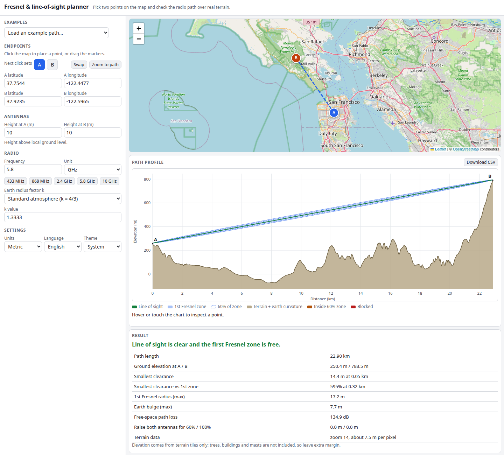

# Fresnel & Line-of-Sight Planner

Will your radio link see over the hills? Click two points on a map and the planner pulls real terrain elevation, plots the path profile with earth curvature, draws the line of sight and the first Fresnel zone, and tells you the clearance, where the path is obstructed and how much higher the antennas must go. Everything runs in your browser.

**Try it: [hermes98761234.github.io/fresnel-los-planner](https://hermes98761234.github.io/fresnel-los-planner/)**

[](https://github.com/hermes98761234/fresnel-los-planner/actions/workflows/deploy.yml)



## Features

- **Pick the path on an OpenStreetMap map** (Leaflet): click to place A and B, drag the markers, or type coordinates.
- **Real terrain**: elevation comes from the free AWS Terrain Tiles (Mapzen Terrarium PNGs), decoded on a canvas with bilinear sampling. The zoom level adapts to the path length.
- **Earth curvature with a k-factor**: geometric (1), standard atmosphere (4/3), sub-refraction (2/3) or your own value.
- **First Fresnel zone and the 60% zone**, clearance in metres and as a percentage of the zone, and a clear / usable / partly obstructed / blocked verdict.
- **Obstruction warnings** listing each blocked stretch and how far the terrain pokes above the line, plus the antenna height increase needed for 60% and 100% clearance.
- **Frequency from 1 kHz up to hundreds of GHz**, free-space path loss, antenna heights at both ends, ready-made examples.
- Hover or touch the chart to inspect a point, which is also marked on the map. Export the profile as CSV.
- **Metric or imperial, English or Ukrainian, light or dark theme.** Settings are remembered in the browser.
- No backend and no tracking. Only map and terrain tiles are requested.

## How it works

The path is the great circle between A and B, sampled at about the terrain pixel size (64 to 500 samples). For each sample at distances d1, d2 from the ends and total distance d:

- Earth bulge: `h = d1·d2 / (2·k·R)` with R = 6371 km.
- Fresnel radius: `F1 = sqrt(λ·d1·d2 / d)`.
- Line of sight: a straight line between the two antenna tips, measured against terrain plus bulge.
- Clearance: `line of sight − (ground + bulge)`, compared with `F1`.

A path is "clear" when the clearance is at least 100% of F1 everywhere, "usable" at 60% or more, "partly obstructed" when positive but below 60%, and "blocked" when negative. The maths lives in `src/lib` and is covered by unit tests against textbook values (for example F1 = 17.67 m at the middle of a 10 km, 2.4 GHz link, and 5.89 m of bulge at the middle of a 20 km path with k = 4/3).

Limitations: terrain tiles contain ground elevation only (no trees or buildings), and their resolution is 5 to 150 m depending on the zoom. Leave extra margin. Map tiles come from openstreetmap.org and terrain tiles from s3.amazonaws.com, so an internet connection is needed.

## Quick start

You need [Node.js](https://nodejs.org/) 22.

```bash
git clone https://github.com/hermes98761234/fresnel-los-planner.git
cd fresnel-los-planner
npm install
npm run dev       # http://localhost:5173
npm test          # geometry, Fresnel, terrain, profile and i18n tests
npm run build     # static site in dist/
```

## License

MIT
